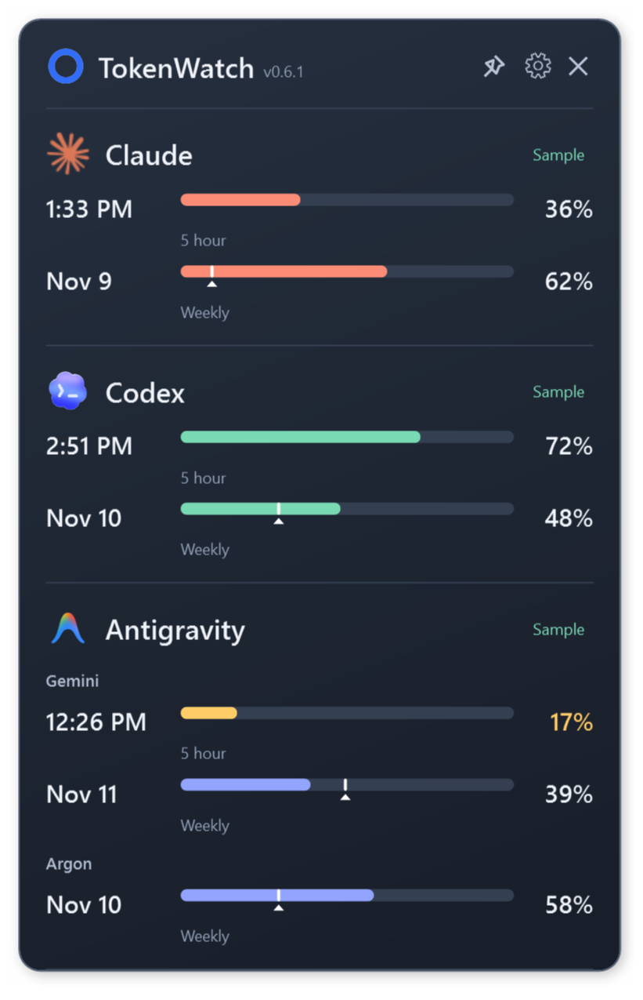

# TokenWatch v0.6.1

A portable Windows x64 tray utility showing subscription quotas for Claude, Codex, Google Antigravity, GitHub Copilot and Cursor. The current release uses WPF and .NET 10. The WinUI 3 implementation is archived under `src/TokenWatch.WinUI`; the current release command is `build.ps1`.

<p align="center">
  
</p>

*Example widget with sample quota data.*

## Download and run

Download from [GitHub Releases](https://github.com/seanodotcom/TokenWatch/releases/latest): [self-contained Windows x64](https://github.com/seanodotcom/TokenWatch/releases/download/v0.6.1/TokenWatch-v0.6.1-win-x64.zip), [framework-dependent Windows x64](https://github.com/seanodotcom/TokenWatch/releases/download/v0.6.1/TokenWatch-v0.6.1-win-x64-framework-dependent.zip), and [SHA-256 checksums](https://github.com/seanodotcom/TokenWatch/releases/download/v0.6.1/TokenWatch-v0.6.1-SHA256SUMS.txt).

Extract `TokenWatch-v0.6.1-win-x64.zip` into a writable folder and run `TokenWatch.exe`. The self-contained edition includes .NET 10 and the Windows Desktop runtime. No installer, administrator rights, Node.js or Windows App SDK is required for TokenWatch itself. Provider sign-in helpers can have their own prerequisites.

The smaller `TokenWatch-v0.6.1-win-x64-framework-dependent.zip` contains `TokenWatch-framework-dependent.exe` and requires the **.NET 10 Desktop Runtime, Windows x64**. The plain .NET runtime is insufficient for WPF. Both editions have the same features.

Windows 10/11 x64 is targeted. This release is validated on the development Windows 11 machine; a separate clean Windows 10 machine and fresh-account onboarding have not been validated. Packages are unsigned unless the build was supplied a signing certificate. Check the release's SHA256SUMS file against the downloaded ZIP.

## Widget

- Drag the header to move it. Resize any edge or corner: side drags change width, top/bottom drags change height, and corners change both independently. Width ranges from 220 to 560 logical pixels; readable content and the monitor work area constrain height. Extra height spreads providers and gently increases text/bar sizes. Your preferred height survives usage changes and restarts. Saved positions recover onto an available monitor.
- The header pin toggles always-on-top. **Keep open when I click elsewhere** is a separate setting.
- Close or Escape hides to the tray. Click the donut tray icon to show the widget. The tray menu offers Show, Keep open, Always on top, Refresh, Settings and Exit. If the notification area is unavailable, the app retains a taskbar recovery path and retries tray registration.
- F5 refreshes usage. Automatic polling continues while hidden. The header donut counts down; right-click it to change the interval. Manual refresh respects server cooldowns.
- Quota changes highlight the affected row and animate its filled bar until the next unchanged successful refresh. Unchanged readings retain their controls. Motion follows Windows animation preferences.
- Settings lets you add, pause, remove and reorder providers, inspect connections, open usage pages and start provider sign-in. Paused providers disappear from the widget; removing one never signs out its provider app. New Copilot and Cursor entries are opt-in. WPF settings use **Save/Cancel**; Cancel discards preference edits. Authentication completed in another app is retained independently.
- Show used / Show remaining applies to all percentages and bars. Unknown values are dashes. Hover over a quota for its full label, reset and display mode. Reset labels show a clock time today and a date for later days.
- **Show expected usage markers** adds a white tick and caret to weekly quotas. **Daily usage budget (%)** defaults to 20 and accepts 1–100. The target is expected cumulative use by today's close, using weekdays, with partial reset days prorated. Weekends hold steady. It follows used/remaining mode and hides for stale, unknown or expired-reset readings. It is a planning guide, not a provider-imposed daily limit.
- Connection activity includes last successful observations and server retry deadlines. Codex and GitHub sign-in open their official CLI; Cursor opens its installed desktop app. Claude setup discovers existing helpers and offers **Set up and sign in**, **Setup guide**, or **Cancel** if no helper is found. Installing a helper only begins after that explicit choice, using Anthropic's official installer.

## Settings and upgrades

Preferences are saved beside the executable in `TokenWatch.settings.json`. Use a writable application folder. When upgrading into a new `TokenWatch-v<version>` folder with no settings of its own, normal startup imports the newest sibling release's live settings, including WinUI v0.5.9 provider choices, pace controls, retry deadlines, executable override, geometry and preferred height. Source settings and provider credentials are never moved or deleted. Demo/isolated runs do not import sibling settings.

Malformed settings recover with defaults and are backed up as `TokenWatch.settings.json.invalid-<timestamp>-<id>` before replacement. If a backup cannot be made, the original file is protected from overwrite. Preferences contain no credentials or quota history.

## Connections

Percentages show **subscription quota used or remaining**, according to your display setting, rather than raw token totals or estimated spending. For example, 44% used equals 56% remaining; Codex's own UI commonly presents remaining quota. The underlying provider observation stays unchanged when you switch modes.

### Claude

Uses the existing Claude Code OAuth sign-in from `%USERPROFILE%\.claude\.credentials.json` (or `CLAUDE_CONFIG_DIR`). Supports `five_hour` and `seven_day` utilization/reset fields. Sign in once through **Settings → Sign in to Claude**, then save and refresh. TokenWatch silently renews the session when a polling check finds it within five minutes of expiry, including after a restart. It also attempts renewal and retries usage once if the access token is rejected. Temporary renewal failures retry automatically; a missing or rejected refresh token requires browser sign-in again. The sign-in button locates an existing standalone CLI or the CLI bundled with Claude Desktop. You can also run `claude auth login` yourself. A Claude Desktop-only sign-in is separate from this Claude Code credential.

Renewal sends the stored refresh token directly to Anthropic's OAuth token endpoint and atomically updates the existing credential file, preserving other fields and its file permissions. TokenWatch coordinates with Claude Code's current and legacy refresh locks, rereads credentials under the lock, and leaves a concurrent browser sign-in untouched. Usage and renewal make no model calls and consume no inference quota. These internal OAuth interfaces and lock conventions can change. Renewal failures wait at least a minute; token-endpoint rate limits honor `Retry-After` within the running process.

Claude's OAuth usage endpoint is an internal interface and may change. HTTP authentication failures, rate limiting, and connection failures have explicit UI states. A 429 response honors `Retry-After` (seconds or HTTP date), displays the next allowed check time, and persists that deadline across restarts. Both automatic polling and manual Refresh respect it. With no usable header, retries back off from five minutes to a maximum of one hour. Last successful readings remain visible and marked stale while the server is unavailable; missing data stays unknown. TokenWatch cannot make Anthropic return usage during a server-imposed cooldown. See https://platform.claude.com/docs/en/api/errors.

### Codex

Detects the Codex desktop CLI, a `codex.exe` on PATH, or the OpenAI VS Code extension's bundled CLI. You can choose another `codex.exe` in Settings. The utility launches its own hidden, short-lived `codex app-server`, performs initialization, and requests `account/rateLimits/read`. It opens no threads and makes no inference calls. Its owned subprocess is terminated after the response or timeout.

Your Codex installation must already be signed in with a ChatGPT subscription. API-key billing does not supply these subscription quota windows. `CODEX_HOME` is inherited from the environment. Quota windows are mapped by duration rather than assuming that primary always means five hours. An absent five-hour or weekly window is labeled as not supplied for the plan. The `codex` bucket is preferred over the legacy single-bucket view.

Protocol reference: https://learn.chatgpt.com/docs/app-server

### Antigravity

Keep Antigravity and a workspace open under the same Windows account. TokenWatch discovers the Antigravity language server through WMI and queries only loopback ports owned by that process, using its local CSRF token. Newer installations supply quota windows through `RetrieveUserQuotaSummary`. Older installations fall back to `GetUserStatus` per-model quotas. **Gemini models and Argon are always shown together**, with headings and no dropdown. Claude/GPT and other model families are excluded from the widget. Five-hour and weekly labels are shortened so they remain consistent with your Show used / Show remaining choice.

Only the windows actually supplied by Antigravity receive usage values: the observed Gemini Models group has five-hour and weekly limits, while Gemini 4 Argon supplies a weekly limit. An absent family remains visible with unknown values. Per-model quotas do not acquire an invented cadence. These local, internal interfaces can change. Antigravity is not required to be installed for the other providers to work.

## Additional providers

### GitHub Copilot (experimental)

Add **GitHub Copilot** in Settings. Install [GitHub CLI](https://cli.github.com/) and use **Sign in with GitHub CLI** (or run `gh auth login --web --hostname github.com`), then **Check connection** and Save. A Copilot subscription is required; some token types or organization policies may deny the internal quota endpoint even when GitHub sign-in succeeds.

TokenWatch first checks `COPILOT_GITHUB_TOKEN`, then existing legacy Copilot `apps.json` OAuth credentials in `%USERPROFILE%\.config\github-copilot` (or `XDG_CONFIG_HOME`) and `%LOCALAPPDATA%\github-copilot`, then runs a hidden `gh auth token --hostname github.com`. Tokens stay in memory and are sent only to `https://api.github.com/copilot_internal/user`. VS Code-only sign-ins and the modern Copilot CLI's Windows Vault are not read directly. TokenWatch never enumerates the credential vault or copies credentials.

Displays the quotas supplied by GitHub: premium requests or AI credits, chat and completions. Unlimited allowances are marked unknown with an explanatory tooltip. Zero-entitlement categories are omitted; missing quotas are unavailable. Counts and percentages follow the server response, with no invented monthly entitlement. The response model is based on [Microsoft's VS Code entitlement definitions](https://github.com/microsoft/vscode/blob/main/src/vs/base/common/defaultAccount.ts) and [quota parser](https://github.com/microsoft/vscode/blob/main/src/vs/workbench/services/chat/common/chatEntitlementService.ts). This is an internal interface, not GitHub's organization-wide analytics API.

### Cursor (experimental)

Sign in in Cursor Desktop under the same Windows account, add **Cursor** in Settings, then check the connection and Save. TokenWatch opens `%APPDATA%\Cursor\User\globalStorage\state.vscdb` read-only using Windows' bundled SQLite and queries only `cursorAuth/accessToken`. It does not read browser cookies, copy the database, refresh tokens, or modify Cursor's credential store. If the session expires, reopen Cursor and sign in again.

The usage-only request goes directly to `https://api2.cursor.sh/aiserver.v1.DashboardService/GetCurrentPeriodUsage` using the existing bearer token. Included usage uses `includedSpend / limit` when supplied, otherwise the reported total percentage. Bonus spend is excluded from the computed ratio. An on-demand budget appears only when an individual cap and usage are supplied; it is labeled separately from the subscription allowance. Team pooled budgets and legacy enterprise request-metered plans are not supported in this first adapter. The observed internal protocol is described by the [OpenUsage provider implementation notes](https://github.com/luisleineweber/usagebar-fork-archive/blob/main/docs/providers/cursor.md); it can change without notice.

Both new providers honor server `Retry-After` cooldowns across restarts. Live account quota readings have not been verified in this release environment; the adapters, failure states and UI were checked with synthetic responses and credentials.

## Privacy and failure behavior

See `PRIVACY.md` for credential access, destinations and local storage. TokenWatch makes usage requests, not inference requests. It has no telemetry or hosted backend. Claude renewal modifies only Claude Code's existing credential store and preserves its file ACL; fresh locks and nonempty/unexpected lock directories are respected. Empty non-reparse locks without a heartbeat for ten minutes can be recovered. Failed checks retain last-good percentages and timestamps and clearly mark them stale; unavailable readings remain unknown.

Claude, Antigravity, Copilot and Cursor rely on internal provider interfaces that may change or become unavailable. These integrations are not provider-endorsed. Claude credential handling requires an appropriate permitted use; the experimental label is not provider permission. Copilot and Cursor live account readings remain unverified in this release environment.

## Build and verification

Install the .NET 10 SDK. `global.json` selects a stable .NET 10 SDK; no local .NET 8 toolchain is used.

```powershell
# Build and run core plus offline native desktop/provider tests
.\build.ps1 -Test

# Release gate: tests, vulnerability audit, both editions, fresh ZIP extraction,
# native tests of each extracted executable, version verification and checksums
.\build.ps1 -Publish

# Build/core-only check for environments without an interactive Windows desktop
.\build.ps1 -CoreTestOnly
```

Tests use synthetic credentials and HTTP responses, never real accounts. Core checks cover parsing, time zones, pace calculations, display modes, cooldowns, geometry, launcher discovery, settings normalization, corrupt-file recovery and migration. Desktop checks cover native tray menus/activation, resizing, saved height, monitor recovery, retained controls, pace settings, provider management, Claude renewal/lock recovery, Cursor read-only SQLite access and failure states.

The core suite is an explicit console runner invoked by the build script, not a `dotnet test`-discovered project. Native checks require an interactive desktop with Explorer. All report paths are printed by the script under `artifacts/verification/`. The release gate fails on failed/missing reports, vulnerable dependencies or an unavailable audit feed. `-DisableNuGetAudit` is an explicit offline escape hatch and is not used for the verified release.

Both executables are written to `dist/TokenWatch-v0.6.1/`: `TokenWatch.exe` and `TokenWatch-framework-dependent.exe`. Matching ZIPs and `TokenWatch-v0.6.1-SHA256SUMS.txt` are written to `dist/`. Packages are assembled from fresh directories and exclude settings, credentials, logs, screenshots and debug symbols. Supply `-CertificateThumbprint <thumbprint>` to sign both binaries using an existing code-signing certificate in the current user's certificate store; signing requires a valid timestamp.

```powershell
# Offline UI checks and sample screenshots
.\dist\TokenWatch-v0.6.1\TokenWatch.exe --demo --isolated --settings .\artifacts\sample.settings.json --ui-smoke .\artifacts\sample-report.json

# Status-only live probe: accesses enabled providers; excludes quota values and credentials
.\dist\TokenWatch-v0.6.1\TokenWatch.exe --probe .\artifacts\provider-status.json
```

Remove the extracted application folder to uninstall TokenWatch. No startup entries, services or scheduled tasks are installed. This does not remove sign-ins or helpers owned by other apps. Dependency and artwork notices are in `THIRD-PARTY-NOTICES.md` and `licenses/`.

## License

TokenWatch's original code is available under the [MIT License](LICENSE). Dependencies and provider artwork retain their own licenses and trademark rights; see [third-party notices](THIRD-PARTY-NOTICES.md).
